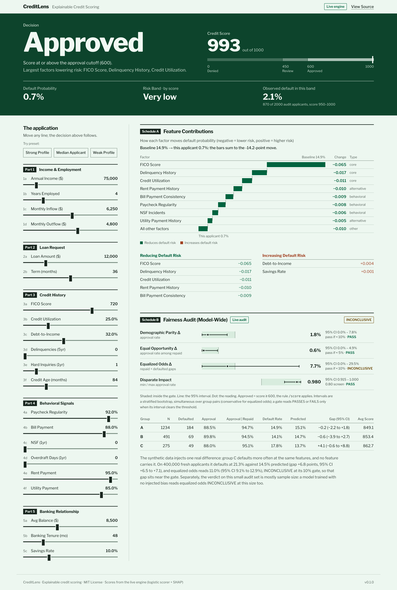

# CreditLens

[](https://github.com/ROROK20/CreditLens/actions/workflows/ci.yml)
[](https://python.org)
[](LICENSE)
[](https://fastapi.tiangolo.com)
[](CONTRIBUTING.md)

**An explainable credit-scoring reference: every decision has an attribution that sums exactly to the served probability, and the fairness audit reports intervals and says INCONCLUSIVE when it should.**

- **Attributions that add up.** `base_value + sum(shap_values)` is the probability the API served, by construction, and shap's independent KernelExplainer agrees within 0.44 point on 12 applicants (2026-11-04). Proof: `pytest tests/test_shap_explainer.py`.
- **An audit that can say it does not know.** On the demo's 2,000 applicants equalized odds reads 0.077, CI 0.000–0.295: INCONCLUSIVE, because a model with no injected bias reads the same at this size. Proof: `pytest tests/test_equalized_odds_interval.py`.
- **A constrained logistic model beat trees here.** On seeds 42, 7 and 123 it has the higher AUC, the lower Brier, under half the unjustified decision flips, and a largest one-point FICO jump of at most 6 points against 142 to 299. Proof: `pytest tests/test_served_model.py`.

**Live demo:** https://creditlens-delta.vercel.app (the engine's recorded model running in your browser, on synthetic data; run the API for live Shapley attributions).

**Run it:** `docker compose up --build`, then open http://localhost:3003.

Synthetic data, demo only, not financial advice. CreditLens has never seen a real applicant and must not be used to make real lending decisions.

<p align="center">
  
  <br>
  <em>Captured 2026-11-05 from a production build against the real engine: the "Live engine" and "Live audit" badges mean every number came from the Python pipeline, and the audit reads <strong>INCONCLUSIVE</strong> (see <a href="#what-the-demo-reports-and-why">what the demo reports</a>). The social-preview image is captured from a build with no backend, what a frontend-only deploy shows.</em>
</p>

---

## Why trust the numbers

- **The docs are executed.** [`tests/test_docs.py`](tests/test_docs.py) runs the Quick Start and every curl example with a documented response, and fails unless the output matches.
- **The signature reproduces in a real browser.** [`node e2e/smoke.mjs`](e2e/smoke.mjs) starts the real API and web UI, then asserts that the default applicant scores 993 / Approved, that the audit covers all 2,000 applicants (groups 1234 / 491 / 275), and that the console shows 0 errors.
- **The ground truth is published, so the model is checked against it.** [`tests/test_generative_links.py`](tests/test_generative_links.py) compares every input's response with its true effect in the generator's label, and fails if the [table below](#model-behaviour), which names the inputs that miss, stops reproducing.
- **A worse signal cannot raise a score.** [`tests/test_monotonicity.py`](tests/test_monotonicity.py) sweeps every input through the served `/score`.
- **The weaknesses are measured too.** [`tests/test_cash_flow_gaming.py`](tests/test_cash_flow_gaming.py) reproduces how many decisions a favourable stated cash flow moves, inside the rules, and what no warning can catch.

---

## Run it

Clone the repo and bring up the real engine and the web UI with one command:

```bash
docker compose up --build      # or: make demo
```

Then open:

- **Web demo** → http://localhost:3003
- **Live API** → http://localhost:8002/health (interactive docs at `/docs`)

The backend trains a logistic scoring model on synthetic data **on startup**, so scoring,
SHAP explanations, and the fairness audit all work with **zero manual steps**.
The web UI shows a **"Live engine"** badge in the header when it is talking to
the real API; if the backend is down it flips to **"Demo data"** and runs the
engine's recorded model in the browser, so the page never breaks and its scores
are still the engine's.

**No Docker?** Run the same stack natively:

```bash
make demo-local                # API on :8002 + Next dev server on :3003
```

### Architecture (frontend → real engine)

```
┌──────────────────────────┐        POST /score              ┌───────────────────────────┐
│  Next.js web UI (:3003)   │ ─────  POST /explain/{idx}  ──▶ │  FastAPI engine (:8002)    │
│  app/page.tsx             │        GET  /fairness/report    │  creditlens/api/app.py     │
│  lib/api.ts (typed client)│ ◀───── real score + SHAP ─────  │  logistic + SHAP + fairness│
│                           │        JSON                     │  (trained on startup)      │
│  on ANY error ↓ fallback  │                                 └───────────────────────────┘
│  lib/engineModel.mjs (the engine's recorded weights)
└──────────────────────────┘
```

The frontend calls the engine at `NEXT_PUBLIC_API_URL`, tries it first, and
renders the genuine probability + SHAP factors. Next inlines that variable at
**build** time, so changing it on a running server does nothing. Unset, `next dev`
uses `http://localhost:8002`, and a production build is demo-only: it makes no
engine call at all. Every API call is wrapped in try/catch so `npm run build` and
a no-backend static deploy still render.

### Deploy

CreditLens deploys as two independent services (no shared secrets — everything
runs on locally generated synthetic data):

- **API (Render):** the repo ships a [`render.yaml`](render.yaml) blueprint and a
  root [`Dockerfile`](Dockerfile). Create a new Render *Blueprint* from this repo;
  it builds the Docker image and serves `uvicorn` on the injected `$PORT`. Health
  check path is `/health`. Memory is what this deploy needs: the first
  `GET /fairness/report`, which the web page calls on load, peaks at about 306 MB in that
  image (cgroup `memory.peak`, aarch64, 2026-11-04; about 150 MB after startup training).
  On macOS the same call peaks near 390 MB of RSS, so a figure depends on the host. The blueprint names
  `plan: free`: check your plan's memory, because below that peak the process can be
  killed on the first page load.
- **Frontend (Vercel):** [`frontend/vercel.json`](frontend/vercel.json) configures
  the Next.js build. Import the `frontend/` directory in Vercel and set
  `NEXT_PUBLIC_API_URL` to your deployed API URL (build-time; redeploy after
  changing it). The UI falls back to demo data if that URL is unreachable, and
  stays demo-only if it is unset. Set `NEXT_PUBLIC_SITE_URL` to the site's own
  origin for social previews; unset, the build ships no preview image rather than
  one pointing at localhost.

---

## Table of Contents

- [Why trust the numbers](#why-trust-the-numbers)
- [Run it](#run-it)
- [The Problem](#the-problem)
- [Features](#features)
- [Architecture](#architecture)
- [Installation](#installation)
- [Quick Start](#quick-start)
- [Web Demo / Frontend](#web-demo--frontend)
- [Fairness Metrics Reference](#fairness-metrics-reference)
- [REST API](#rest-api)
- [Testing](#testing)
- [Project Structure](#project-structure)
- [Regulatory Context](#regulatory-context)
- [Contributing](#contributing)
- [Security](#security)
- [Code of Conduct](#code-of-conduct)
- [Changelog](#changelog)
- [License](#license)

---

## The Problem

Traditional credit scoring is a black box:
- **Opaque:** "Your score is 620. Application denied." — No explanation.
- **Narrow:** about 45M US adults have no credit record or one too thin to
  score (26M "credit invisible" + 19M unscorable — CFPB, *Data Point: Credit
  Invisibles*, 2015).
- **Biased:** Proxy variables create disparate impact along demographic lines.

CreditLens is a reference implementation of one answer to each: cash-flow
features alongside the bureau score, a per-decision Shapley attribution of the
probability it serves (checked against an independent estimator), and a
fairness audit that reports its own uncertainty. It runs on synthetic data and
fixes nothing in production lending by itself. It does not reach the
credit-invisible: this demo requires a FICO score (see
[Model behaviour](#model-behaviour)).

---

## Features

- **Cash-flow and payment signals alongside the bureau score** — NSF incidents, overdrafts, bill, rent and utility payments, paycheck regularity, net cash flow, savings, balance and banking tenure, each with a documented effect in the synthetic data (see [Model behaviour](#model-behaviour))
- **Sign-constrained logistic regression (served), XGBoost and MLP for comparison** — `LogisticScorer` is the correct form in its features for the synthetic label and the standard scorecard form; each weight is bounded to its documented risk direction, so a worse credit signal can never raise the score (see [Why logistic regression](#why-logistic-regression)). `XGBoostScorer` and an optional MLP (`NeuralNetScorer`) share its interface and stay in the library; the API serves neither and no ensembling code exists
- **SHAP Explainability** — Every decision comes with interventional Shapley values of the *served* P(default) over the applicant's own inputs, so every reason names something the applicant supplied; inputs the API couples (income with its cash flows and balance, the delinquency count with its recency) move together as one factor. They are computed against a fixed background of 1,000 training applicants, every k-th by served probability so the baseline is the population's mean, from 32 antithetic permutations: each factor is the average change in the served probability when that input switches from another applicant's value to this one's. Base value + contributions equal the returned P(default) exactly by construction; agreement with an independent estimator (shap's KernelExplainer on the same function and factors, against a 50-row slice of that background, whose cost grows with the rows) is what is tested: on the API model every factor above 1 point agrees in sign and the largest per-factor gap on 12 applicants is 0.44 point (2026-11-04); the tests allow 1.5 points, the two estimators' measured Monte-Carlo error with margin. Redrawing the background moves them this much: over 10 shifted samples of the background, on 20 not-approved applicants (2026-11-04), the baseline stays 14.87% to 14.96%, no factor moves by more than 1.35 points, and the top 3 reasons change for 10% of the not-approved, the top 4 for 25%. `/explain` evaluates 608,000 model states: its median was 484 ms in-process (fastest 246 ms) on one contended machine (2026-11-04). Contributions are associations in this model, not causes
- **Fairness Audit** — Demographic parity, equal opportunity, equalized odds and disparate impact on the decision the API serves, each with a bootstrap confidence interval and a PASS / FAIL / INCONCLUSIVE verdict, calibration by group with its interval, and the same audit on a large fresh draw (screening diagnostics, not a legal compliance test — see [Regulatory Context](#regulatory-context))
- **REST API** — FastAPI endpoints for real-time scoring and explanation
- **Synthetic Data Generator** — Seeded synthetic credit dataset. By default group C defaults more often at the same features (an outcome gap no feature carries); the opt-in `group_c_fico_shift` understates group C's reported FICO so the audit has a real disparity to catch (see [Quick Start](#quick-start))

---

## Architecture

```
Applicant Data
     │
     ▼
Feature Engineering
  ├── Traditional: FICO, DTI, utilization, delinquencies
  ├── Alternative: cash flow, bill payments, NSF, rent, banking tenure
  └── Derived: the loan's payment burden, net cash flow
     │
     ▼
Credit Scorer
  ├── LogisticScorer (sign-constrained; what the API serves)
  ├── XGBoostScorer (kept for comparison, unused by the API)
  └── NeuralNetScorer (optional MLP, unused by the API)
     │
     ├──→ SHAP Explainer ──→ IndividualExplanation (why approved/denied)
     │
     ├──→ Fairness Auditor ──→ FairnessReport
     │       ├── Demographic Parity
     │       ├── Equal Opportunity
     │       ├── Equalized Odds
     │       └── Disparate Impact (0.80 screen)
     │
     └──→ REST API (FastAPI)
```

### Why logistic regression

The API serves `LogisticScorer`: logistic regression with each weight bounded to
the documented direction of its feature's risk (scipy's L-BFGS-B over standardised
inputs; deterministic, no new dependency). The synthetic default label is a
logistic function of these features plus a group-C shift and label noise the model
never sees (`creditlens/data/generator.py`), so this is the correct form in the features
it has, though not the whole generating process, and it is the standard credit-scorecard
form. Real lending data would not be this
cooperative; the choice is about this generator and about a response a reader can
check.

A tree is a step function, and on an additive logit it lumps an input's effect at
its split points. Depth-1 XGBoost on the same features and data scores one applicant
414 / Denied at FICO 487 and 597 / Review at 488, and 414 at every FICO from 350 to
487; a strong profile at FICO 350 reads P(default) 0.24 where the label's own
probability is about 0.60. On the served model a strong profile at FICO 350 reads P(default) 0.56 against the label's 0.60, and that
applicant moves a few points per FICO point all the way down.
`XGBoostScorer` stays in the library and tested, so the comparison keeps
reproducing (`tests/test_served_model.py`; measured 2026-11-05 on Linux x86-64, the
platform CI runs, with the API's training configuration, 2,000 held-out applicants,
the same features):

| Seed | Model | AUC | Brier | Unjustified flips | Largest one-point FICO jump |
|---|---|---:|---:|---:|---:|
| 42 | logistic | 0.8564 | 0.0917 | 26 of 782 (3.3%) | 5 |
| 42 | XGBoost stumps | 0.8526 | 0.0926 | 75 of 654 (11.5%) | 184 |
| 7 | logistic | 0.8655 | 0.0893 | 42 of 860 (4.9%) | 6 |
| 7 | XGBoost stumps | 0.8579 | 0.0910 | 85 of 639 (13.3%) | 299 |
| 123 | logistic | 0.8731 | 0.0888 | 28 of 787 (3.6%) | 5 |
| 123 | XGBoost stumps | 0.8611 | 0.0910 | 65 of 786 (8.3%) | 142 |

Unjustified flips are the total over the [proportionality table](#model-behaviour).
The logistic rows are the same on macOS arm64. The XGBoost rows are not, because the
same pinned version trains slightly differently there: seed 42 reads AUC 0.8514, 74 of
656 flips and a 197-point jump, and the applicant above goes from 421 / Denied to
617 / Approved. Logistic leads on every measure on both platforms, and the test
retrains both models to check that wherever it runs.
The one thing trees gave for free, a guaranteed direction, is kept by the weight
bounds: where the data would give an input the wrong sign, its weight is exactly 0.

**How far one small step can move a score.** For 200 audit applicants, every
numeric input is swept across its validity domain in single steps, among states
the API accepts, and the largest change in the score is recorded, with the same
sweep through the label's own probability beside it (`tests/test_served_model.py`
fails if this table stops reproducing; measured 2026-11-04). The bound: no FICO point moves a score more than 6, and no small step more than 15 (the largest, `months_since_delinquency`, is 14); whole
events (one more delinquency or NSF, a loan term or income step at the bottom of
its range) move it as far as the label says, and the largest single step anywhere is `first_delinquency`, 500 points (the label's own step: 467).
The ceiling is arithmetic: a logistic curve's slope is at most 0.25, so a step
moves a score by at most 250 x its change in log-odds.

| Input | Step | Model | Label |
|---|---|---:|---:|
| `fico_score` | 1 point | 5 | 5 |
| `debt_to_income` | 0.01 | 9 | 8 |
| `credit_utilization` | 0.01 | 7 | 6 |
| `num_delinquencies` | 1 more | 210 | 213 |
| `months_since_delinquency` | 1 month | 14 | 12 |
| `num_hard_inquiries` | 1 more | 45 | 36 |
| `credit_age_months` | 1 month | 1 | 1 |
| `nsf_count` | 1 more | 74 | 84 |
| `overdraft_days` | 1 day | 10 | 5 |
| `bill_payment_consistency` | 0.01 | 4 | 3 |
| `paycheck_regularity` | 0.01 | 2 | 2 |
| `rent_payment_score` | 0.01 | 4 | 3 |
| `utility_payment_score` | 0.01 | 3 | 2 |
| `savings_rate` | 0.01 | 6 | 6 |
| `banking_tenure_months` | 1 month | 1 | 1 |
| `employment_years` | 1 year | 6 | 7 |
| `avg_account_balance` | $100 | 2 | 3 |
| `loan_amount` | $100 | 4 | 3 |
| `loan_term_months` | 1 month | 112 | 104 |
| `monthly_inflow` | $100 | 5 | 4 |
| `monthly_outflow` | $100 | 5 | 4 |
| `annual_income` | $1,000 | 23 | 19 |
| `first_delinquency` | never to 1, this month | 500 | 467 |

### Model behaviour

- **This demo requires a FICO score.** `fico_score` is a required input, so
  CreditLens does not score the credit-invisible applicants described above;
  it shows cash-flow and payment-behaviour signals alongside a bureau score.
- **The data is a stated ground truth, not a simulation of lending.** The generator's
  features are mostly independent draws from hand-chosen distributions: inflow, outflow
  and balance follow income, the offered rate follows FICO, delinquency recency follows the
  delinquency count, and the rest is drawn on its own. On the default 10,000 rows
  (2026-11-04) FICO's correlation is -0.007 with delinquencies, 0.009 with utilization and
  -0.007 with income, and banking tenure exceeds credit age on 37.7% of rows. It shows the
  method, with an answer to check against; it says nothing about real applicants.
- **Every model input has a documented effect on the synthetic default
  label, and nothing else is a model input.** The label
  (`creditlens/data/generator.py`, `default_log_odds` and `LABEL_EFFECTS`)
  is driven by the bureau fields (FICO, debt-to-income, utilization,
  delinquencies and their recency, hard inquiries, credit age), the
  cash-flow and payment fields (NSF incidents, overdraft days, bill-payment
  consistency, paycheck regularity, rent and utility payments, net cash flow,
  savings rate, account balance, banking tenure), employment years, and the
  new loan's payment burden (loan amount ÷ term ÷ monthly income), each with a
  stated, modest coefficient, plus the group-C outcome gap and noise. Four
  generated fields have no effect on it and are therefore not model inputs
  (the API rejects them): `num_open_accounts`, `num_subscriptions`,
  `loan_purpose` and the offered `interest_rate`. FICO carries the strongest
  signal: it is the top risk factor in 43 of the first 60 not-approved audit
  applicants (2026-11-04).
- **Monotone, in the generator's direction, end to end.** Every model
  weight is bounded (`LogisticScorer`, `RISK_DIRECTION` in
  `creditlens/features/engineering.py`) to the direction of its effect in the
  label, and every raw input moves every engineered feature it feeds the same
  way, so the served score is monotone in each input
  (`tests/test_generative_links.py` checks the directions against the label;
  `tests/test_monotonicity.py` sweeps the served `/score`).
- **Effects are learned in rough proportion, not exactly, and the table says
  how rough.** Direction is not enough. For each input, every not-approved
  audit applicant (225 of the 2,000) gets that input improved by the stated
  amount, inside the training range and the API's rules. The table compares
  the change in the model's log-odds with the change in the generator's true
  `default_log_odds`, then counts flips to Approved; a flip is unjustified when
  the true change, applied to the same applicant, would not have crossed the
  cutoff (`tests/test_generative_links.py` fails if any figure here stops
  reproducing; measured 2026-11-04).

| Input | Improved by | Model / true | Flips to Approved | Unjustified |
|---|---|---:|---:|---:|
| `fico_score` | +1 SD | 0.96 | 176 | 0 |
| `debt_to_income` | -1 SD | 0.98 | 65 | 0 |
| `credit_utilization` | -1 SD | 1.03 | 67 | 1 |
| `delinquency_history` | one fewer, recency with it | 0.97 | 54 | 0 |
| `months_since_delinquency` | +12 months | 1.12 | 13 | 1 |
| `num_hard_inquiries` | -1 SD | 1.20 | 25 | 8 |
| `credit_age_months` | +1 SD | 1.17 | 34 | 2 |
| `nsf_count` | -1 SD | 0.85 | 20 | 0 |
| `overdraft_days` | -1 SD | 1.97 | 8 | 7 |
| `bill_payment_consistency` | +1 SD | 1.09 | 31 | 1 |
| `paycheck_regularity` | +1 SD | 0.76 | 19 | 0 |
| `rent_payment_score` | +1 SD | 1.00 | 30 | 0 |
| `utility_payment_score` | +1 SD | 1.11 | 18 | 0 |
| `savings_rate` | +1 SD | 0.84 | 20 | 0 |
| `avg_account_balance` | +1 SD | 0.57 | 13 | 0 |
| `banking_tenure_months` | +1 SD | 0.85 | 20 | 0 |
| `employment_years` | +1 SD | 0.76 | 16 | 0 |
| `loan_amount` | -1 SD | 1.08 | 24 | 1 |
| `loan_term_months` | +12 months | 1.08 | 14 | 0 |
| `monthly_inflow` | +10% | 1.31 | 11 | 0 |
| `monthly_outflow` | -1 SD | 1.31 | 32 | 1 |
| `annual_income` | +20%, flows unchanged | 1.08 | 8 | 0 |
| `income_cash_flow_and_balance` | x2, flows and balance with it | 1.04 | 64 | 4 |

  Across the table 26 of the 782 flips (3.3%) are unjustified, inside the 20%
  bar, and on seeds the table was not measured on it holds too (seed 7: 42 of
  860 (4.9%); seed 123: 28 of 787 (3.6%)). On the served model the largest response is `overdraft_days`, 1.97x.
  Not every input clears every bar by itself, and these claim no proportionality.
  Over 1.4x: `overdraft_days` 1.97. Under-learned (ratio below 0.6): `avg_account_balance` 0.57. Over the 20% bar on their own: `num_hard_inquiries` 8 of 25, `overdraft_days` 7 of 8. These are
  estimation error rather than a defect of form: the fitted weights lie within
  about two standard errors of the label's, and `overdraft_days` is the label's
  smallest effect (0.02 log-odds a day, estimated at 0.039 with a standard error of
  0.027 on 8,000 rows), so its ratio is large while its error is 0.02 log-odds on
  this move. Its 8 flips are 1% of the table. Over seeds 1–50 and 123
  `overdraft_days` runs from 0.00x to 3.87x (seed 9), and no other input exceeds 1.86x (`avg_account_balance`, seed 43); on seeds 3, 5, 7, 22, 23, 26, 38, 47 its weight is exactly 0
  (the data gave it the wrong sign), and every seed is at most 14.2% unjustified (seed 43), under the 20% bar. Setting rent
  and utility to 1.0 together moves the log-odds 1.05x the true
  change (81 flips, 4 unjustified). Doubling stated income alone is a `422`; the
  model's own response to it is 1.08x (median).
- **Delinquency recency stops counting at 24 months**, where the label's
  recency risk ends: the feature is capped there and "never delinquent" sits
  at the cap. A delinquent applicant's mean score is flat past it (788 from 24 to
  119 months), and the API bounds the field at 120.
- **Scored only inside its validity domain.** The model has no evidence
  beyond its training data: a logistic model extends its straight line there, which
  is no evidence at all. Every input is bounded to the
  default training data's observed range plus a 5% margin (`422` outside;
  the table is in [SECURITY.md](SECURITY.md), the derivation in
  `creditlens/data/domain.py`), with five joint rules: monthly inflow must be
  0.78 to 1.22 x annual income / 12 (the training data draws 0.80 to 1.20 x),
  monthly outflow 0.47 to 0.98 x inflow (it draws 0.50 to 0.95 x), the average
  balance 0.37 to 3.13 x annual income / 12 (it draws 0.5 to 3.0 x), the monthly loan
  payment at most 2.8 x monthly income, and inflow minus outflow inside the net cash
  flow range (-1,200 to 25,000). FICO 300 to 349 is therefore a `422`: the synthetic
  data's lowest FICO is 374. Inside the domain, a value outside the training data's
  central 99% is scored and named in the response's `warnings`.
- **Stated cash flow can still be gamed inside the rules, and no rule here can stop
  it.** Every input is self-reported and the API has no way to check one. Claiming inflow
  1.2 x monthly income, outflow 0.503 x inflow and a balance 2.988 x monthly income, each
  allowed, moves 56 of the 225 not-approved applicants among the 2,000 held out to
  Approved; 25 of those 56 defaulted, and one defaulter goes from 300 / Denied to 616 /
  Approved. A real lender must verify cash flow independently, from bank statements or
  account data it obtains itself, before acting on these scores. Each ratio is flagged
  near its edge, and two or
  more of the three ratios in their most favourable tenth at once draw their own warning,
  so all 56 carry a new warning (74 of the 2,000 unmodified held-out applicants (3.7%)
  carry it too). That catches only the crude version: claiming 1.14 x, 0.56 x and 2.73 x,
  just inside those edges, still moves 45 to Approved (18 defaulted), 42 of them with no
  new warning (17 defaulted). A warning cannot close this; verification can.
- **Probabilities are bounded by the model, not by a certainty.** On the 2,000 API
  test applicants P(default) runs from 0.0002 to 0.9878 (scores 12 to 1000; 2026-11-04): P(default) = 0 for 0 of
  the 2,000 and P(default) = 1 for 0 of the 2,000, though 6 applicants round to
  1000. The web demo's Weak preset shows 99.9%. Neither end is a real certainty.
  The logistic output tracks the observed default rate: by quintile of
  predicted risk, 0.6% / 2.6% / 6.6% / 15.6% / 48.7% predicted against 1.0% / 3.2% / 8.0% / 15.2% / 48.0% observed. A production
  model would bound the probability; this demo reports what it computes.
- **The offered interest rate is not a model input.** The synthetic lender
  prices the rate from the FICO score (correlation between FICO and the offered
  rate on the training data: -0.92). A score that consumes the lender's own
  risk-based price is circular: the price is an outcome of the credit
  decision, and as a "reason" it only restates FICO. The model never sees it; the
  generator records it, for reference.
- **Risk bands are measured, and there is no APR.** Five bands of the score, defined by
  P(default) against the 14.9% base rate (at most 5%, at most 15%, at most 40%, then the
  review and denied bands), each with its observed default rate on the 2,000 audit
  applicants, live in `/fairness/report` as `score_bands` (2026-11-04; a test requires
  the rates to order on seeds 42, 7 and 123). This project has no pricing model, so it
  shows no price. The page's default applicant sits at the 87th percentile of the audit
  set, so the middle preset is Median Applicant, every input near its training median.

| Band | Score | Audited | Share | Observed default |
|---|---:|---:|---:|---:|
| Very low | 950–1000 | 870 | 43.5% | 2.1% |
| Low | 850–949 | 547 | 27.4% | 10.2% |
| Elevated | 600–849 | 358 | 17.9% | 26.0% |
| High | 450–599 | 82 | 4.1% | 41.5% |
| Very high | 0–449 | 143 | 7.1% | 70.6% |

- **The approval cutoff is illustrative, not a risk appetite.** "Approved"
  means score ≥ 600, i.e. P(default) ≤ 0.40, about 2.7 times the 14.9%
  training default rate, so the demo approves 1775 of the 2,000 audited
  applicants (88.8%). A lender would set the cutoff from expected loss,
  pricing and capital; this one exists only so the API, the explanation and
  the fairness audit share one rule (`creditlens/decision.py`).

---

## Installation

Python **3.12+** is required (the pinned dependency set in `requirements.txt`
declares it — `shap==0.52.0` alone floors at 3.12).

```bash
git clone https://github.com/ROROK20/CreditLens.git
cd CreditLens

# Recommended: an isolated virtual environment
python3 -m venv .venv
source .venv/bin/activate        # Windows: .venv\Scripts\activate

pip install -e .                 # runtime only

# The shap package (the "xai" extra). The engine computes its attributions
# itself; the test suite uses shap's KernelExplainer as an independent check
pip install -e ".[xai]"

# Everything the Testing section below needs (SHAP + pytest/pytest-cov/httpx):
pip install -e ".[xai,dev]"      # or: make install
```

---

## Quick Start

The whole pipeline (data, model, SHAP explanation, fairness audit), then the
same audit on an opt-in dataset built to contain the disparity it should catch:

```python
import textwrap

from creditlens.data.generator import generate_credit_dataset, DatasetConfig, train_test_split
from creditlens.features.engineering import FeatureEngineer
from creditlens.models.scorer import LogisticScorer, evaluate_model
from creditlens.fairness.metrics import FairnessAuditor
from creditlens.explainability.shap_explainer import SHAPExplainer

# 1. Generate synthetic data (seeded: every number below reproduces)
df = generate_credit_dataset(DatasetConfig(n_samples=10_000, seed=42))
train_df, test_df = train_test_split(df)

# 2. Feature engineering
engineer = FeatureEngineer()
X_train, y_train = engineer.fit_transform(train_df)
X_test, y_test = engineer.transform(test_df)

# 3. Train the API's scorer: sign-constrained logistic regression
model = LogisticScorer().fit(X_train, y_train)

# 4. Evaluate on the 2,000 held-out applicants
eval_ = evaluate_model(model, X_test, y_test)
print(f"AUC-ROC: {eval_.auc_roc:.3f}   Gini: {eval_.gini_coefficient:.3f}")

# 5. Explain one decision: each INPUT's contribution to the served P(default)
explainer = SHAPExplainer.over_inputs(model, engineer).fit(train_df)
explanation = explainer.explain_individual(test_df.iloc[[0]], applicant_id=1)
print(explanation.explanation_text)

# 6. Fairness audit of the rule /score applies (approved = score >= 600)
def audit(model, X, y, groups):
    report = FairnessAuditor().audit(y.values, model.predict_proba(X)[:, 1], groups)
    print(report)
    for name, c in report.checks.items():
        print(f"  {name:18s} {c.value:.3f}  95% CI {c.ci_low:.3f}-{c.ci_high:.3f}  {c.verdict}")
    for g, m in report.group_metrics.items():
        print(f"  group {g}: n={m.n_samples}, defaulted={m.n_positive}, "
              f"approved {m.approval_rate:.1%}, approved if repaid {m.approval_rate_repaid:.1%}")
    return report

audit(model, X_test, y_test, test_df["demographic_group"].values)

# 7. Opt-in: a dataset the audit SHOULD flag. Group C's reported FICO is
#    understated by 80 points (one standard deviation) while their default
#    risk follows the true score.
biased = generate_credit_dataset(DatasetConfig(n_samples=10_000, seed=42, group_c_fico_shift=80))
b_train, b_test = train_test_split(biased)
b_engineer = FeatureEngineer()
Xb_train, yb_train = b_engineer.fit_transform(b_train)
Xb_test, yb_test = b_engineer.transform(b_test)
b_model = LogisticScorer().fit(Xb_train, yb_train)
report = audit(b_model, Xb_test, yb_test, b_test["demographic_group"].values)
print(textwrap.fill(report.recommendations[0], 88))
```

Output (reproduced 2026-11-04 on CPython 3.12.5 with the exact pins in
`requirements.txt`; `tests/test_docs.py` runs the block above and fails unless
it prints exactly this):

```text
AUC-ROC: 0.856   Gini: 0.713
Credit Decision: Approved
Credit Score: 906/1000
Estimated Default Probability: 9.4%

Baseline default probability 14.9%; this applicant's features move it to 9.4%.
Largest factors raising the estimated risk:
  ✗ Debt To Income (+7.9 pts)
  ✗ Utility Payment Score (+1.0 pts)
  ✗ Credit Age Months (+0.9 pts)
Largest factors lowering the estimated risk:
  ✓ Credit Utilization (-5.5 pts)
  ✓ Fico Score (-4.0 pts)
  ✓ Delinquency History (-3.4 pts)

Score at or above the approval cutoff (600).
FairnessReport(INCONCLUSIVE | dem_parity_diff=0.018 | disparate_impact=0.980)
  demographic_parity 0.018  95% CI 0.000-0.078  PASS
  equal_opportunity  0.006  95% CI 0.000-0.049  PASS
  equalized_odds     0.077  95% CI 0.000-0.295  INCONCLUSIVE
  disparate_impact   0.980  95% CI 0.915-1.000  PASS
  group A: n=1234, defaulted=184, approved 88.5%, approved if repaid 94.7%
  group B: n=491, defaulted=69, approved 89.8%, approved if repaid 94.5%
  group C: n=275, defaulted=49, approved 88.0%, approved if repaid 95.1%
FairnessReport(FAIL | dem_parity_diff=0.186 | disparate_impact=0.798)
  demographic_parity 0.186  95% CI 0.118-0.258  FAIL
  equal_opportunity  0.137  95% CI 0.074-0.204  FAIL
  equalized_odds     0.483  95% CI 0.175-0.783  FAIL
  disparate_impact   0.798  95% CI 0.724-0.871  INCONCLUSIVE
  group A: n=1234, defaulted=184, approved 90.7%, approved if repaid 96.4%
  group B: n=491, defaulted=69, approved 92.1%, approved if repaid 96.4%
  group C: n=275, defaulted=49, approved 73.5%, approved if repaid 82.7%
Demographic parity FAILS: 0.186 for B vs C (95% CI 0.118–0.258; B: n=491, 69 defaulted,
C: n=275, 49 defaulted); threshold 0.1. Beyond it with 95% confidence: A vs C 0.172 (CI
0.108–0.240), B vs C 0.186 (CI 0.118–0.258). Find which inputs drive the gap (the per-
applicant attributions of /explain) and whether any is measured differently for one
group — a biased input, such as the opt-in demo's understated group-C FICO, has to be
corrected in the data. Reweighing (mitigation_reweighting, passed as
LogisticScorer.fit(sample_weight=)) removes only a group-label association in the
training data and cannot repair a biased input.
```

How to read it:

- **Default data: INCONCLUSIVE, mostly because the audit set is small.** The
  generator draws the demographic group independently of every feature and the model
  never sees the group, so approval rates match across groups by construction
  (demographic parity and disparate impact both PASS here: 0.018 and 0.980). On these
  2,000 applicants equal opportunity passes (0.006, CI 0.000–0.049) and equalized
  odds' interval straddles its gate (0.077, CI 0.000–0.295). At this size that verdict
  is mostly sample size: a model trained with no injected bias reads it too. Separately,
  the default data carries one injected difference, `group_c_bias`: group C defaults
  more often at the *same* features. No feature carries it, so the model cannot act on
  it and under-predicts group C's risk, and on a large population that gap sits near
  the gate ([what the demo reports](#what-the-demo-reports-and-why)).
- **Opt-in biased data: FAIL.** `DatasetConfig(group_c_fico_shift=80)`
  understates group C's *reported* FICO by 80 points (one standard deviation of
  the synthetic scores) while their default risk still follows the true score,
  as when positive payment history never reaches the bureau. The model then
  denies creditworthy group-C applicants: approval when repaid falls to 82.7%
  against 96.4% for group A, and demographic parity, equal opportunity and
  equalized odds all fail with their whole interval beyond the threshold.
  Shifts of 80 and 100 points, and seed 7 at 80, read FAIL; equalized odds
  clears its threshold by a wide margin (interval from 0.175). A 60-point shift
  reads INCONCLUSIVE on every criterion, equalized odds included (0.402, CI 0.094–0.698):
  its lower bound stops just short of the gate, and demographic
  parity there is INCONCLUSIVE (0.152, CI 0.083–0.222).
  Disparate impact reads 0.798, below 0.80 on the point estimate, but its
  interval (0.724–0.871) cannot clear the screen, so it reports INCONCLUSIVE
  rather than FAIL. The shift is off by default (`0.0` leaves the dataset
  byte-identical) and is never applied to the data the API trains on.

---

## Web Demo / Frontend

An interactive Next.js 15 web demo lives in [`frontend/`](frontend). It provides
a live applicant-scoring playground with a 0–1000 score rail marking the 450 and 600 cutoffs, a
SHAP-style contribution waterfall, top positive/negative factor lists, and a
model-wide fairness dashboard — including three preset profiles (Strong /
Median Applicant / Weak).

```bash
cd frontend
npm install
npm run dev
# Open http://localhost:3003
```

Production build:

```bash
cd frontend && npm run build
```

> The demo calls the real engine first: with the [REST API](#rest-api) running
> it shows a **"Live engine"** badge, and the score, default probability,
> decision, risk band, SHAP factors and fairness audit come from the Python pipeline,
> with no number on screen until it has answered: the audit card reads "Audit pending"
> while the report is outstanding, and asks again if the call fails. With no backend reachable it flips to
> **"Demo data"** and runs the engine's served model from recorded weights
> (`frontend/lib/engineSnapshot.json`, `make snapshot`), so the page still runs
> standalone: scores, refusals and warnings match the engine's, and the audit is a
> labelled recording. Its factors are log-odds against the average applicant, not the live
> Shapley values; the page says so. A page that loses its engine says "Demo data" and
> "Demo audit" until the engine answers again, checking every 10 seconds. The presets are
> Strong, Median Applicant (every input near its training median) and Weak.

---

## Fairness Metrics Reference

"Approved" is the decision `/score` returns (score ≥ 600, defined once in
`creditlens/decision.py`); an applicant is "qualified" if they repaid. Each
criterion is the worst value over group pairs (i, j):

| Criterion | Measured on each group pair | Passes if |
|-----------|-----------------------------|-----------|
| Demographic parity | \|P(approved \| i) − P(approved \| j)\| | < 0.10 |
| Equal opportunity | \|P(approved \| repaid, i) − P(approved \| repaid, j)\| (Hardt, Price & Srebro 2016, lending form) | < 0.05 |
| Equalized odds | \|Δ P(approved \| repaid)\| + \|Δ P(approved \| defaulted)\| | < 0.10 |
| Disparate impact | min / max of the two approval rates | ≥ 0.80 |

**Verdicts are interval-aware.** Every criterion depends only on each group's
approved × repaid table, so intervals come from a stratified bootstrap of those
tables (20,000 seeded replicates): percentile intervals of signed differences,
Bonferroni-adjusted so a criterion's pairwise intervals hold simultaneously at 95%. A criterion reads **PASS** only
when every pair's interval lies inside the threshold, **FAIL** only when one
lies entirely beyond it, and **INCONCLUSIVE** otherwise; the overall verdict is
FAIL if any criterion fails, PASS if all four pass. One limit, stated
precisely: the 95% holds within each criterion, simultaneously over its group
pairs, but nothing adjusts across the four criteria, so when all four truly
pass the overall verdict can still read FAIL by chance up to 20% of the time
(Bonferroni over four criteria at 5% each; about 10% if each interval's tails
are symmetric). Every report carries the
per-group sample sizes (applicants, repaid, defaulted) behind each interval.
Too little data is never a pass: with fewer than two groups every criterion is
INCONCLUSIVE, and a
group pair cannot be judged when a group has fewer than 30 applicants, or
fewer than 10 repaid or defaulted applicants for a criterion that conditions
on them; the report says which and why.

**The equalized-odds interval covers the truth, and it is conservative.** Equalized
odds is a sum of two absolute gaps, so its interval comes from the two signed gaps: each gets a
percentile interval at 99.17% (Bonferroni over 3 pairs x 2 gaps), each maps to its
absolute gap, and the bounds add, so the lower bound reaches 0 whenever both signed
intervals span 0. Conservative here means wide: the two gaps rarely sit at their
extremes together, so coverage runs above 95% and a verdict arrives later than a
tighter interval's would. It does not bootstrap the sum itself: noise only ever raises a
sum of absolute values, so on a fair model such an interval would sit wholly above the
truth. Coverage of each pair's true gap, A–B / A–C /
B–C, measured 2026-11-04 on the seed-42 model with and without the injected bias, on
audits drawn from 1.6 million applicants (true worst gap 0.004 with no bias, 0.110
with it; 300, 200, 100 and 50 audits by size):

| Data | Audited | Mean reading | Coverage | PASS / FAIL / INCONCLUSIVE |
|------|---------|--------------|----------|----------------------------|
| no bias | 2,000 | 0.109 | 0.993 / 0.983 / 0.983 | 0 / 0 / 300 |
| no bias | 10,000 | 0.052 | 0.990 / 0.985 / 0.995 | 0 / 0 / 200 |
| no bias | 50,000 | 0.023 | 1.000 / 0.990 / 0.980 | 95 / 0 / 5 |
| no bias | 100,000 | 0.015 | 1.000 / 1.000 / 0.980 | 50 / 0 / 0 |
| default bias | 2,000 | 0.146 | 0.993 / 0.997 / 1.000 | 0 / 1 / 299 |
| default bias | 10,000 | 0.125 | 0.995 / 1.000 / 0.995 | 0 / 2 / 198 |
| default bias | 50,000 | 0.116 | 1.000 / 1.000 / 1.000 | 0 / 4 / 96 |
| default bias | 100,000 | 0.110 | 1.000 / 1.000 / 1.000 | 0 / 0 / 50 |

The point estimate keeps its upward bias, which is why the verdict reads the interval:
at 2,000 audited it reads 0.109 on average against a true 0.004 with no bias, and 0.146
against 0.110 with it. Demographic parity and equal opportunity each resample one signed
difference and carry no such bias.

**How large an audit separates fair from biased.** Drawing audits from the same two
populations, a model with no bias reads PASS on 0 of 300 audits of 10,000, 14 of 300
at 20,000, 161 of 300 at 30,000, 287 of 300 at 50,000 and 200 of 200 at 100,000. The
default bias reads PASS on none at any size measured, up to 6.4 million. So about 50,000
audited applicants, 25 times this demo's 2,000, separate the two. Reading FAIL on the
biased model takes far more, because its gap sits so near the gate: 27 of 200 audits at
400,000, 151 of 200 at 1.6 million, 199 of 200 at 3.2 million (2026-11-04).

Reported but not gated: predictive parity (`predictive_parity_diff`, the worst pair's
gap in P(default | not approved)), and **calibration within groups**
(observed minus mean predicted default rate, with an interval simultaneous over
groups). When base rates differ, calibration and error-rate parity cannot all
hold at once (Kleinberg, Mullainathan & Raghavan 2016; Chouldechova 2017), so
gating on both would fail every audit by construction.

### What the demo reports, and why

**On the API's 2,000 held-out applicants** (startup model, reproduced 2026-11-04) the
audit reads **INCONCLUSIVE**. Demographic parity (0.018, CI 0.000–0.078), equal opportunity (0.006, CI 0.000–0.049) and disparate impact
(0.980, CI 0.915–1.000) pass; the interval of equalized odds (0.077, CI 0.000–0.295) straddles 0.10. Group C's
calibration gap here is +4.1 points (CI -0.6 to +8.8), an interval this audit set cannot separate from
zero, and the report says exactly that.

**At this size that verdict is mostly sample size.** A model trained with no injected
bias (`DatasetConfig(group_c_bias=0)`) reads equalized odds INCONCLUSIVE on all 100 of
training seeds 1–100, with a mean reading of 0.115 and a mean upper bound of 0.377;
with the bias the same seeds read 0.152 and 0.396. Seed 42 reads 0.131 with no bias and
0.077 with it. An audit of 2,000 cannot tell these two apart (`tests/test_equalized_odds_interval.py`).

**Separately, the injected bias sits near the gate on a large population.** `GET /fairness/report`
also audits the served model under `population`, and the web demo's fairness card
shows the result (`tests/test_fairness_population.py` fails if a figure here stops
reproducing; measured 2026-11-04). On 400,000 fresh applicants (seed 2026) equalized odds reads 0.110 (CI 0.091–0.129),
INCONCLUSIVE at that size; demographic parity 0.001, equal opportunity 0.018 and
disparate impact 0.998 all PASS. Over ten such draws (seeds 2026–2035) it averages 0.110 (range 0.100–0.119; 9 INCONCLUSIVE, 1 FAIL). So the
true gap is about 0.11, just past the 0.10 gate: this model narrowly misses equalized
odds on this data, and a verdict of FAIL needs millions of applicants.

**The injected bias is real, and the model under-predicts it.** `group_c_bias` adds
0.8 to group C's log-odds of default at the same features. On that draw group C defaults at 21.3% against 14.5% predicted
(gap +6.8 points, CI +6.5 to +7.1); groups A and B sit within a point of theirs. Over the ten draws group C's default rate exceeds group A's by 7.6 points (the default 10,000 rows happen
to read 5.6). Since the model scores group C's defaulters like everyone else's, it
approves 60.8% of group C's defaulters against 51.6% of group A's, which is most of the
equalized-odds gap. Nothing the model sees carries the difference, so no refit on these inputs can predict it.

**The verdict moves with the training seed.** Over training seeds 1–19 at the API's size the overall verdict reads INCONCLUSIVE 19 times:
equalized odds ranges 0.064–0.286, never decided; equal opportunity PASSes on 3 of the 19 and
demographic parity on 17; group C's calibration interval excludes zero on 15 of the 19. That window
is no kinder than the wider one: over seeds 1–100 it reads INCONCLUSIVE 99 times and FAIL once (seed 88,
on equalized odds: 0.325, CI 0.111–0.527), and equalized odds ranges
0.035–0.325 over that window. Seed 33 reads 0.294, CI 0.093–0.501, while the same model reads 0.115 on
a large draw, so one audit set's reading can sit far from its model's true gap. Seed 42's own
audit set is not typical: its equalized odds is among the lower readings. At
`n_samples=50000` (10,000 audited), seed 42 reads INCONCLUSIVE (0.105) and seed 7 reads FAIL (0.218). The intervals
cover the audit set's sampling only, so a single seed's verdict is one draw of this.

The audit scores the held-out applicants exactly as `/score`
does — every model input, nothing imputed — so it audits what the API and the
web form serve (`tests/test_required_inputs.py` checks all 2,000).

The 0.80 disparate-impact screen is borrowed from the EEOC's *Uniform
Guidelines on Employee Selection Procedures* (29 C.F.R. § 1607.4(D), the
"four-fifths rule"), which govern **employment selection, not lending**.
Neither ECOA / Regulation B nor the Fair Housing Act prescribes it, or any of
the thresholds above. They are screening heuristics.

---

## REST API

```bash
# Start server
uvicorn creditlens.api.app:app --reload --port 8002

# (Re)train on synthetic data. OFF by default (403): /train is unauthenticated
# and replaces the model for every caller, so the server must be started with
# CREDITLENS_ENABLE_TRAIN=1 to accept it. With no body it rebuilds exactly the
# model the server already trained at startup (10,000 rows, seed 42), so the
# response below reproduces either way. Train something else by sending a JSON
# body (n_samples 2,000-50,000), e.g.
#   -H "Content-Type: application/json" -d '{"n_samples": 10000, "seed": 7}'
curl -X POST http://localhost:8002/train

# Score an applicant. Every input the model uses is required (422 if one is
# missing) and nothing is ever filled in for you. Net cash flow is not an input:
# the engine derives it as monthly_inflow - monthly_outflow, always, and sending
# it is a 422. Types are strict: "700" is not a number.
# There is no interest-rate input (sending one is a 422): the offered rate is
# the lender's own risk-based price, an outcome of the decision, not evidence.
curl -X POST http://localhost:8002/score \
  -H "Content-Type: application/json" \
  -d '{"annual_income": 75000, "loan_amount": 12000, "loan_term_months": 36,
       "fico_score": 680,
       "debt_to_income": 0.32, "employment_years": 4, "credit_utilization": 0.45,
       "credit_age_months": 84, "num_hard_inquiries": 2,
       "num_delinquencies": 0, "months_since_delinquency": -1,
       "monthly_inflow": 6250, "monthly_outflow": 4800, "avg_account_balance": 8500,
       "paycheck_regularity": 0.8, "bill_payment_consistency": 0.8,
       "nsf_count": 0, "overdraft_days": 0, "rent_payment_score": 0.8,
       "utility_payment_score": 0.8, "banking_tenure_months": 12,
       "savings_rate": 0.1}'
# {"credit_score": 951, "default_probability": 0.0491, "decision": "Approved",
#  "decision_reason": "Score at or above the approval cutoff (600).",
#  "warnings": []}
#
# Reproduced from code 2026-11-04, from the startup model AND after a
# body-less POST /train (tests/test_docs.py re-runs this exact payload
# against both on every test run). Deterministic, not illustrative: the
# pipeline is seeded end to end (seed=42 in data/generator.py, the train/test
# split in api/app.py), and the fit is deterministic. What CAN move these values
# is the dependency set, which is why requirements.txt pins exact versions. Bump a
# pin, re-run the tests, and update this block.

# Get fairness report
curl http://localhost:8002/fairness/report

# Get model metrics
curl http://localhost:8002/model/metrics
```

### Deployment note (single-worker demo)

The API keeps its trained model, feature engineer, evaluation, fairness report
and SHAP explainer in an in-memory, **per-process** dict (`_model_state` in
`creditlens/api/app.py`). This is a single-worker demo by design — run it with
one worker (the default `uvicorn creditlens.api.app:app`). Under multiple
workers (`--workers N`, or gunicorn) each worker trains and holds its **own**
copy of the model, so a `POST /train` handled by one worker is invisible to the
others, and `/score` or `/explain` on a different worker will lazy-train a
separate model. For a real multi-worker deployment, persist the fitted model to
shared storage (load from file / object store) or front it with a model server
rather than relying on this per-process state.

If SHAP attribution fails for a request, `/explain` does **not** silently return
empty factors: it returns the valid score/decision with
`explanation_status: "unavailable"` (plus a reason), and the frontend renders an
explicit "explanation unavailable" state.

---

## Testing

The test tooling ships in the `dev` extra — install it first
(`pip install -e ".[xai,dev]"`, or `make install`), then:

```bash
pytest tests/ -v --cov=creditlens

# Output:
# tests/test_scorer.py::TestXGBoostScorer::test_auc_above_random PASSED
# tests/test_fairness.py::TestFairnessAuditor::test_biased_model_fails_checks PASSED
# tests/test_features.py::TestFeatureEngineer::test_derived_features_created PASSED
# 526 passed, 0 skipped        # re-run 2026-11-05 on CPython 3.12.5
```

Or run the whole suite plainly:

```bash
pytest tests/
```

**Live-fire smoke test** — end-to-end proof that the documented demo numbers
(the default applicant's `993` score, the full-data fairness audit across all
three demographic groups) reproduce over HTTP *and* in a real browser against
the real engine, with 0 console errors. It self-starts the API (:8002) and web
UI (:3003), asserts the signature, then tears both down:

```bash
(cd frontend && npm install && npx playwright install chromium)   # one-time
node e2e/smoke.mjs                                                 # exits 0 on success

# Port 8002 taken by something else, or `python3` lacks the pinned packages?
CREDITLENS_API_PORT=8012 CREDITLENS_PYTHON=python3.12 node e2e/smoke.mjs
```

`node e2e/offline.mjs` (`make offline`) proves a production build with no public
URLs in a real browser: no request leaves the site, the page says it is showing
demo data, the score is the engine's recorded answer, and no localhost URL is
advertised. `node e2e/capture.mjs`
(`make capture`) re-takes the README screenshot from a build against the live engine
and the social image from a build with no backend, in one run, and writes what each
page rendered inside its PNG; `tests/test_capture.py` reads that record back out, and
fails if one image changes without the other, if the sidecar is edited instead, or if
they stop showing what the engine serves.

---

## Project Structure

```
creditlens/
├── creditlens/
│   ├── data/           # Seeded synthetic dataset generator (+ opt-in biased mode)
│   ├── features/       # Feature engineering: FICO + alternative data
│   ├── models/         # Logistic (served), XGBoost + MLP scorers, evaluation metrics
│   ├── explainability/ # SHAP individual + global explanations
│   ├── fairness/       # Demographic parity, equalized odds, disparate impact
│   └── api/            # FastAPI REST endpoints
├── tests/              # Pytest test suite
└── requirements.txt
```

---

## Regulatory Context

Context, not a compliance claim. The laws below motivate the diagnostics;
none of them prescribes these metrics or thresholds, and passing this audit is
not evidence of compliance with any of them:
- **Equal Credit Opportunity Act (ECOA) / Regulation B** — prohibit
  discrimination in any aspect of a credit transaction, and require specific
  principal reasons when credit is denied. `/explain` lists the model's largest
  SHAP contributions; that is not a compliant adverse-action notice.
- **Fair Housing Act (FHA)** — prohibits discrimination in residential
  real-estate-related lending, including by disparate impact.
- **EU AI Act (Regulation (EU) 2024/1689)** — classes creditworthiness
  assessment of natural persons as high-risk (Annex III); CreditLens implements
  none of its obligations.

---

## Contributing

Contributions are welcome! Please read the [Contributing Guide](CONTRIBUTING.md)
for setup instructions, the test/lint workflow, branch and PR conventions, and
our [Conventional Commits](https://www.conventionalcommits.org/) standard. Bug
reports and feature requests use the GitHub issue forms.

## Security

Found a vulnerability? Please **do not** open a public issue. Follow the
[Security Policy](SECURITY.md) and report it privately to
rohan.s.khiani.vora@gmail.com. We aim to acknowledge reports within 48 hours.

## Code of Conduct

This project follows the [Contributor Covenant](CODE_OF_CONDUCT.md). By
participating, you are expected to uphold it.

## Changelog

See [CHANGELOG.md](CHANGELOG.md) for the release history (Keep a Changelog +
SemVer).

## License

MIT © [Rohan Khiani](https://github.com/ROROK20). See [LICENSE](LICENSE) for
the full text.

> **Disclaimer:** CreditLens uses synthetic data and is a research and
> educational reference implementation. It is **not** a production
> credit-decisioning system and must not be used to make real lending decisions.
